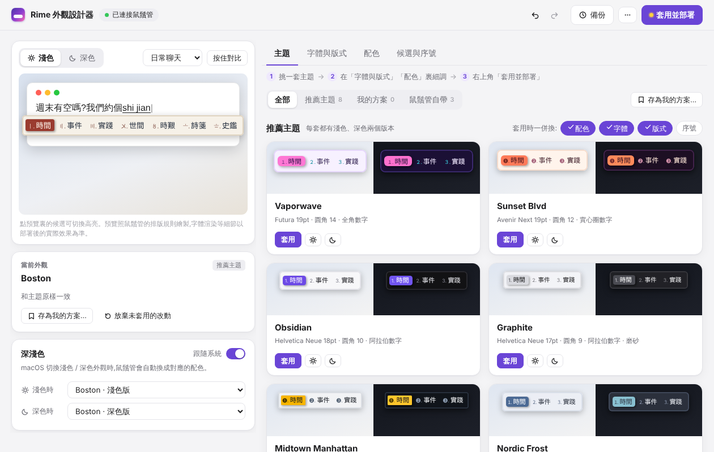
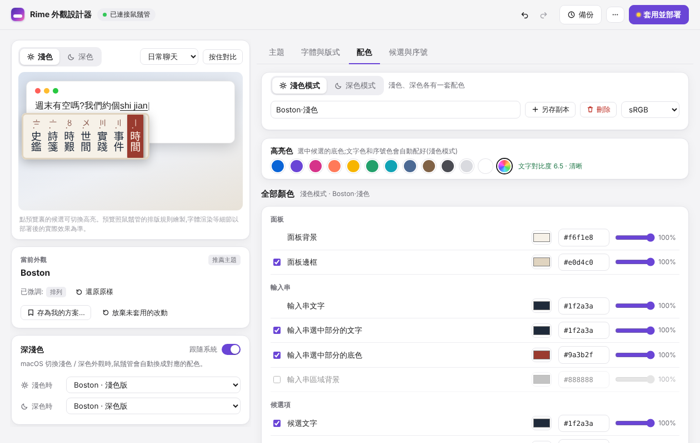

# Rime 外觀設計器

給 macOS 上的 [鼠鬚管(Squirrel)](https://github.com/rime/squirrel) 輸入法調整候選框外觀的小工具:配色、字體、版式、序號、深淺色,改動即時預覽,一鍵寫入配置並重新部署。



## 功能

- **即時預覽**:按鼠鬚管自己的排版規則繪製候選框(內距 = 邊框值 + 圓角、邊框線寬、行距、高亮塊、翻頁箭頭),連排 / 疊排、橫向 / 豎向(古書式從右往左)都能看到;鼠標停在主題卡片上就能先預覽,按住「對比」看改動之前的樣子。
- **主題庫**:8 套推薦主題(每套都有淺色、深色兩個版本)、鼠鬚管自帶的配色方案,以及你自己保存的「我的方案」。
- **深淺色跟隨系統**:淺色模式和深色模式各選一套配色(對應 `style/color_scheme` 與 `style/color_scheme_dark`),macOS 切換外觀時鼠鬚管自動換。
- **細調**:字號(序號、註釋按比例跟着變)、字體與回退鏈、圓角、內距、行距、陰影、磨砂;高亮色一鍵換,文字色自動配好並顯示對比度;14 個配色鍵逐項可調。
- **候選與序號**:每頁候選數、序號樣式(阿拉伯數字、全角、帶圈、羅馬、漢字、蘇州碼子……)、候選格式。
- **安全**:只改 `~/Library/Rime/` 下的 `squirrel.custom.yaml` 和 `default.custom.yaml`;每次寫入前自動備份,可固定「基幹版本」、有回收站、可一鍵還原並部署。寫入前會自檢:生成的 YAML 重新讀入後必須和界面狀態完全一致,否則不寫。
- **順手**:撤銷 / 重做(⌘Z / ⇧⌘Z)、⌘S 套用並部署、界面跟隨系統深淺色。



## 安裝

需要 macOS 11 以上、已安裝並用過一次鼠鬚管(在 1.1.2 上測試)。不需要另外安裝任何依賴:界面跑在 macOS 自帶的 Perl 上。

```sh
git clone https://github.com/TsaichengLiu/rime-appearance-designer.git
cd rime-appearance-designer
python3 build.py          # 生成 dist/Rime外觀設計器.app
```

把 `dist/Rime外觀設計器.app` 拖到「應用程序」或任何地方,雙擊打開。

- 本機有 Xcode 命令行工具時,第一次打開會把 `window.m` 編譯成原生窗口程序(按本機架構,Apple 晶片上是 arm64),之後直接用緩存;沒有命令行工具時改用 macOS 自帶的 JavaScript for Automation 創建窗口。兩種都不行時會留下一份診斷文件,並讓你決定是否改用瀏覽器打開。
- 應用的主程序是一個 shell 腳本。為了避免 macOS 把它當成 Intel 程序交給 Rosetta,`Info.plist` 聲明了 `LSArchitecturePriority = arm64`,啟動器發現自己被轉譯時也會用 `arch -arm64` 重新執行。

## 用法

1. 在「主題」裏挑一套(或在左側「深淺色」裏給淺色、深色分別選配色);
2. 在「字體與版式」「配色」「候選與序號」裏細調,左側預覽即時變化;
3. 點右上角「套用並部署」(⌘S)。沒有改動時這個按鈕是「重新部署」,可以單純讓鼠鬚管重新部署一次。

調好的整套外觀可以「存為我的方案」,以後一鍵套用。歷史版本在「備份」裏。

## 文件存放

| 內容 | 位置 |
| --- | --- |
| 寫入的配置 | `~/Library/Rime/squirrel.custom.yaml`、`~/Library/Rime/default.custom.yaml` |
| 備份、我的方案、日誌、編譯好的窗口程序 | `~/Library/Application Support/RimeAppearanceDesigner/` |

本地服務只監聽 `127.0.0.1`,每次啟動生成隨機令牌,並檢查 Host / Origin;界面關閉後服務自動退出。

## 開發

```
src/            界面:index.tpl.html、style.css、core.js(讀寫配置,純函數)、preview.js(候選框預覽)、themes.js(主題與預設)、app.js(界面邏輯)
server.pl       本地服務(只用 Perl 核心模塊):讀寫配置、備份與還原、我的方案、觸發重新部署
window.m        原生窗口(Objective-C + WKWebView)
window.js       備用窗口(JXA)
app/            .app 骨架:Info.plist、啟動器、圖標
assets/         圖標源文件 icon.svg 和生成 AppIcon.icns 的腳本
vendor/         js-yaml 4.1.0(MIT)
tests/          核心邏輯與主題對比度測試
build.py        把界面內聯成單個 HTML,並組裝 .app
```

```sh
node tests/test_core.js     # 配置讀入 → 生成 → 再讀入,語義不變
node tests/contrast.js      # 推薦主題的文字對比度(WCAG)
```

## 作者

[TsaichengLiu](https://github.com/TsaichengLiu)。

本項目在 Anthropic 的 AI 助手 [Claude](https://claude.ai) 協助下完成:需求、設計方向和在真機上的試用由作者負責;界面、預覽、本地服務、啟動器、圖標和測試的代碼主要由 Claude 編寫和調試。

## 致謝

- [RIME / 鼠鬚管](https://github.com/rime/squirrel):預覽的排版規則參照了鼠鬚管的源碼。
- [js-yaml](https://github.com/nodeca/js-yaml)(MIT)。

## 許可證

[MIT](LICENSE)。內含的 js-yaml 使用 MIT 許可證(見 `vendor/js-yaml/LICENSE`)。
